# Tweets2Insights

**面向事件的舆情分析与研究工作台：从社交文本出发，连接自动弱标注、分布分析、证据追溯与条件推演。**

[](backend/pyproject.toml)
[](frontend/package.json)
[](doc/architecture.md)

[核心能力](#features) · [快速开始](#quickstart) · [第一次分析](#first-analysis) · [系统架构](#architecture) · [文档](#documentation)

Tweets2Insights 将一次事件研究组织为可追溯的工作流：导入帖子和评论，或按关键词与时间范围采集；前端选择复盘、训练预测和调控情景，由 Leader 编译阶段依赖。高阅读量随机样本用于选定标签，模型对全部输入自动弱标注，论坛按证据缺口调用分析工具、补充搜索和解释图表，最后形成交互报告。预测采用可训练 PCA 隐空间、联合 HK 和集合卡尔曼滤波（EnKF），解码回标签分布；当前为实验模型。

项目采用 **Next.js 工作台 + FastAPI Gateway + LangGraph Agent Runtime + MCP 领域工具 + 独立 Worker**。Agent 负责规划和专业评阅；数据处理、数值计算与报告生成由领域模块执行，任务配置和产物按版本保存。

<a id="features"></a>
## 核心能力

| 能力 | 项目中的实现 |
|---|---|
| **事件驱动的数据接入** | 上传标准 JSON、选择已有数据；内置 X 官方归档搜索，其他平台由本机连接器扩展。 |
| **自动弱标注** | 高阅读量随机抽样 → Schema Agent → Jev / 阿里 decision / GLM；完整类别概率、自动拒判、覆盖率与版本缓存。 |
| **分布与证据分析** | 41 个保留工具入口覆盖情绪、话题、地区、互动和 NLP；继承本项目第二阶段选工具、补数据、补搜索、补图的反馈机制。 |
| **预测与条件情景** | 训练截止点内拟合 PCA 和 HK 参数；隐空间同化、解码预测、六种模型/基线滚动诊断；相同起点与随机流下比较措施及资源成本。 |
| **可追溯报告** | 内容整理 Agent → 社科解释 Agent → 页面组织 Agent；交互图表、证据和来源表，支持 Markdown、HTML、JSON、ZIP。 |
| **持续运行的工作台** | 会话、图检查点、SSE 事件流、持久任务、取消、重试及产物查看；采集登录等待状态可恢复。 |

**生产流程使用模型弱标注，标注后自动进入分析，不逐条安排人工复核。** 人工标注仅用于独立 Demo 的方案评测。自动校验、字段拒判、失败记录、预算和版本追溯仍保留；缺失或失败不会被填成“中性”。

Jev 与阿里 decision 使用原生 System One 适配器。GLM 负责生成式 Agent 推理，与弱标注模型独立配置。视觉及其他平台通过[连接器](doc/modules/architecture-rewrite.md#外部服务接入)扩展。阶段流程、论坛角色和工具说明见[完整工作流](doc/modules/full-workflow.md)。

<a id="quickstart"></a>
## 快速开始

### 1. 准备环境并获取代码

| 依赖 | 要求 |
|---|---|
| Python | 3.12 或更高版本，依赖由 UV 管理 |
| Node.js | 22 或更高版本，前端使用 npm |
| Git | 用于获取仓库与更新代码 |
| 服务凭据 | 执行模型流程需要 GLM，以及所选搜索服务的 API Key |

```bash
git clone --branch refine https://github.com/Hyacehila/Tweets2Insights.git
cd Tweets2Insights
uv sync --project backend --frozen
npm --prefix frontend ci
```

以下命令均在包含 `backend/` 和 `frontend/` 的**仓库根目录**执行。根目录另有旧环境配置，新应用使用 `--project backend` 指定后端环境。

### 2. 配置模型与搜索服务

首次使用时，从模板创建 `.env`，保留已有配置。

**Windows PowerShell：**

```powershell
if (!(Test-Path .env)) { Copy-Item .env.example .env }
```

<details>
<summary>Linux / macOS</summary>

```bash
test -f .env || cp .env.example .env
```

</details>

在 `.env` 中填写本机凭据。以下以 Tavily 为例；占位文本需替换为实际密钥：

```dotenv
GLM_API_KEY=your-glm-api-key
TAVILY_API_KEY=your-tavily-api-key
```

若选择 DeepSeek Search，则填写 `DEEPSEEK_API_KEY`，并在工作台或运行请求中选择 `deepseek`。每次运行只使用一个搜索供应商。模型名称在 [`config.yaml`](config.yaml) 中设置，默认 Agent 模型为 `glm-4.5-air`；单次领域标注模型由运行请求的 `labels.model` 指定。

也可在工作台“模型与数据 API 配置”保存本机凭据；密钥只写入忽略文件 `.provider-secrets.json`，读取接口只返回是否已配置。Jev 使用 `TYPESAFE_API_KEY`；阿里使用 `DASHSCOPE_API_KEY` 和业务空间 `ALIYUN_DECISION_ENDPOINT`；X 使用 `X_BEARER_TOKEN`。环境变量和界面配置二选一即可，详见[配置说明](doc/configuration.md)。

### 3. 启动工作台

```bash
uv run --project backend python scripts/dev.py start
```

启动器同时启动 Gateway、领域 Worker 和 Next.js 开发服务器。默认地址：

| 入口 | 地址 |
|---|---|
| 研究工作台 | [http://127.0.0.1:3000](http://127.0.0.1:3000) |
| Gateway API 文档 | [http://127.0.0.1:8001/docs](http://127.0.0.1:8001/docs) |

停止服务：

```bash
uv run --project backend python scripts/dev.py stop
```

日志默认保存在 `.app-state/gateway.log`、`.app-state/worker.log` 和 `.app-state/frontend.log`。启动失败或页面无法访问时，查看对应服务的日志。

<a id="first-analysis"></a>
## 第一次分析

1. **新建事件会话**：使用 `rain` 等事件 ID。同一事件的多个会话共享该事件的数据和领域任务。
2. **选择输入与阶段**：上传标准 JSON 或选择关键词采集；设置时间范围、复盘/预测/情景、论坛角色、模型及调用预算。
3. **生成计划**：点击“将阶段与参数写入运行配置”，检查 JSON，再生成计划。也可清空配置后自然语言规划。生成式模型和决策模型分别设置。
4. **提交执行**：Worker 按阶段完成搜索、标注和分析，任务面板显示状态及停止原因。
5. **查看产物**：选择任务中的分析或报告产物，查看有界数据和报告预览，并下载结果。

例如，可以在选定数据后描述：

> 使用已上传的数据和 Tavily 搜索，分析 2026 年 10 月 1 日至 8 日的城市暴雨讨论。按天统计主题、情绪和立场分布，保留缺失情况与来源引用，本次只做事件复盘。

编辑器中已有结构化请求时，系统优先使用该请求；需要重新由 Agent 规划时，先点击“清空配置，重新由 Agent 规划”。“停止 Agent”只停止当前会话运行，已提交的领域任务需在任务卡片中另行取消。

<details>
<summary>上传数据格式</summary>

上传文件为 JSON 数组，元素遵循 [`PostRecord`](backend/src/domain/opinion_core/schemas/records.py)。字段示例：

```json
[
  {
    "post_id": "example-001",
    "platform": "example",
    "raw_id": "001",
    "kind": "post",
    "content": "暴雨后道路积水，希望尽快公布排水进展。",
    "published_at": "2026-10-01T10:00:00Z",
    "time_status": "parsed"
  }
]
```

时间使用含时区的 ISO 8601 格式。`published_at` 有值时，`time_status` 必须为 `parsed`；时间未知时保留缺失状态。旧格式数据可通过[迁移入口](doc/modules/domain-application.md#兼容入口)转换。

</details>

<details>
<summary>通过 CLI 提交同一条领域工作流</summary>

```bash
uv run --project backend python -m src.tools.cli register --event rain --file posts.json
uv run --project backend python -m src.tools.cli plan --request run.json
uv run --project backend python -m src.tools.cli submit --request run.json
```

先将 [`configs/domain-run.example.json`](configs/domain-run.example.json) 保存为 `run.json`，用注册返回的 `dataset_id` 替换占位值，并调整日期和研究目标。该模板包含预测与情景配置；仅复盘时，将 `objectives` 设为 `["retrospective"]`，移除 `model` 和 `scenarios`。

CLI 提交后同样需要领域 Worker；默认启动器已经包含它。独立使用 CLI 时，可另开终端运行：

```bash
uv run --project backend python -m src.tools.worker
```

同一 `event_id/run_id` 的配置会冻结，修改配置需使用新的 `run_id`。任务查询、重试与导出命令见[运行手册](doc/modules/domain-application.md)。

</details>

<a id="architecture"></a>
## 系统架构



用户在前端选择输入、时间范围和研究阶段。Leader Agent 生成运行请求，领域服务编译阶段依赖，由 DomainWorker 顺序执行。

- **共享准备**：接入数据，高阅读量随机样本辅助 Schema Agent 选词；决策模型标注全部输入，再构建固定窗口观测。
- **事件复盘**：DataAgent 选择分析工具，论坛按需启用专业角色，由 ForumHost 协调补数据、补图和外部搜索。
- **预测与情景**：PCA、联合 HK 与 EnKF 构成实验预测模型；措施模拟使用配对基线，比较效果和成本并形成条件建议。
- **报告生成**：ContentAgent 整理内容，SocialScienceAgent 结合理论解读，ReportUIAgent 组织交互报告页面。

[系统分层](doc/architecture.md) · [论坛协作](doc/modules/full-workflow.md#与原第二阶段的对应) · [预测与情景](doc/modules/full-workflow.md#实验预测与调控建议)

### 项目目录

```text
Tweets2Insights/
├── config.yaml                 # 主应用配置
├── extensions_config.json      # MCP 与技能配置
├── backend/
│   ├── pyproject.toml          # UV 后端环境
│   ├── langgraph.json          # 图入口
│   ├── src/
│   │   ├── agents/             # Leader、中间件、记忆、检查点
│   │   ├── gateway/            # FastAPI 与 6 组 API 路由
│   │   ├── subagents/          # 专业角色与受限评阅
│   │   ├── models/             # 模型工厂
│   │   ├── mcp/                # MCP 客户端
│   │   ├── tools/              # 领域工具、CLI 与 Worker 入口
│   │   ├── skills/             # 技能加载
│   │   ├── sandbox/            # 受限线程文件区
│   │   ├── config/             # 配置加载
│   │   └── domain/             # 标注、证据、分析、预测、情景、报告
│   └── tests/                  # 后端单元与集成测试
├── frontend/src/
│   ├── app/                    # 页面与布局
│   ├── components/             # 工作台、任务及产物界面
│   ├── hooks/                  # SSE 事件流
│   └── lib/                    # API 客户端与类型
├── skills/                     # public 项目技能与 custom 扩展
├── docker/                     # Dockerfile、Compose、Nginx、K8s
├── scripts/                    # 启动、停止与静态检查
├── configs/                    # 运行请求与连接器示例
├── doc/                        # 使用、设计与研究文档
└── legacy/                     # 原 PocketFlow 兼容入口
```

领域源码位于 `backend/src/domain`；根目录同名包保留导入转发。旧 Streamlit 专项视图和 PDF 导出位于 `intelligent_ui`。完整目录见[项目目录](doc/project-structure.md)。

<a id="configuration"></a>
## 配置与扩展

| 配置位置 | 管理内容 |
|---|---|
| [`config.yaml`](config.yaml) | Gateway 地址、状态目录、默认 Agent 模型、上下文和调用上限 |
| [`.env.example`](.env.example) → `.env` | API Key、真实连接器和价格配置文件位置 |
| [`extensions_config.json`](extensions_config.json) | 启用的 MCP 服务及技能 |
| [`RunRequest`](backend/src/domain/opinion_core/schemas/workflow.py) | 每次任务的数据、时间窗口、唯一搜索供应商、标注、数值模型和预算 |
| [`skills/public`](skills/public) / `skills/custom` | 内置与本机自定义技能；自定义技能需在扩展配置中启用 |

当前 Agent 模型工厂使用 GLM SDK；弱标注可选择 GLM、Jev、阿里 decision 或自定义连接器；搜索提供 Tavily/DeepSeek。采集内置 X 官方接口，并保留其他平台扩展。单次领域任务的模型/搜索预算、采集分页上限和 Agent 会话调用上限分别记录，详见[配置说明](doc/configuration.md)。

### Docker 与 Kubernetes

仓库提供 Gateway、Worker、前端及 Nginx 的部署模板。配置 `.env` 后，可使用开发 Compose：

```bash
docker compose -f docker/docker-compose-dev.yaml up --build
```

默认入口为 `http://127.0.0.1:2026`。Compose 与 Kubernetes 配置见[部署说明](doc/deployment.md)和 [K8s 快速开始](K8S_QUICK_START.md)。服务面向本机单用户，访问控制与凭据管理见 [SECURITY.md](SECURITY.md)。

<a id="documentation"></a>
## 文档导航

| 想了解的内容 | 文档 |
|---|---|
| 完整文档入口 | [文档索引](doc/README.md) |
| 启动、CLI、任务管理、导出与兼容入口 | [运行手册](doc/modules/domain-application.md) |
| 分层设计与目录 | [系统架构](doc/architecture.md) · [目录总览](doc/project-structure.md) |
| Leader、检查点、MCP 与子 Agent | [Agent Runtime](doc/modules/agent-runtime-architecture.md) |
| 模型、环境变量与连接器 | [配置](doc/configuration.md) · [连接器协议](doc/modules/architecture-rewrite.md) |
| 数据契约与弱标注 | [契约](doc/modules/opinion-contracts.md) · [自动标注](doc/modules/automatic-labeling.md) |
| 前端与部署 | [前端说明](doc/frontend-guide.md) · [部署说明](doc/deployment.md) |

## 反馈与贡献

通过 [Issues](https://github.com/Hyacehila/Tweets2Insights/issues) 反馈问题或建议。参与贡献请阅读 [CONTRIBUTING.md](CONTRIBUTING.md)，安全问题说明见 [SECURITY.md](SECURITY.md)。

## 参考项目

- [DeerFlow](https://github.com/bytedance/deer-flow)：Agent Runtime 分层的架构参考，其 README 的快速开始与配置导航也用于本页组织参考。
- [BettaFish](https://github.com/666ghj/BettaFish)：参考其舆情分析项目的能力说明、流程介绍和目录呈现方式。
- [Tweets2Insights 原第二阶段](doc/modules/stage2_analysis.md)：论坛能力的直接设计来源，保留并改进工具选择、图表补全、补搜、反思与收敛机制；角色按任务启用。
- [Open Deep Research](https://github.com/langchain-ai/open_deep_research)：参考其将快速开始、模型/搜索配置与评测分开说明的结构。

许可证文件待补充。
