# Tweets2Insights 项目架构

应用采用 Next.js + FastAPI + LangGraph；领域任务由独立 Worker 执行。
DeerFlow 提供运行时分层参考，业务阶段独立设计；论坛以本项目原第二阶段为直接基础，角色和补证路径由任务决定。参考范围见 [Agent Runtime 说明](modules/agent-runtime-architecture.md)。

## 系统总览

前端提交数据或关键词，并选择复盘、预测、情景与论坛角色。Leader Agent 生成或校验运行请求，
领域服务编译依赖，由 DomainWorker 按计划顺序执行。复盘使用工具与论坛循环；预测和情景共用训练后的模型状态；
结果汇入内容整理、社科解释和页面组织三个 Agent，生成报告。

高阅读量抽样用于确定标签；标注接收全部输入，观测再按时间、平台、帖子类型与字段有效性筛选。
选择情景阶段时，计划自动加入模型训练、同化和基线预测。

## 分层与依赖方向

| 层 | 实际位置 | 职责 |
|---|---|---|
| 前端 | `frontend/src` | 会话、上传、结构化配置、SSE 状态、任务及产物 |
| 应用层 | `backend/src/gateway` | HTTP 协议、生命周期、事件范围、会话执行 |
| Agent Runtime | `backend/src/agents`、`subagents` | LangGraph 图、上下文、检查点、有限专业评阅 |
| 通用能力 | `backend/src/models`、`mcp`、`tools`、`skills`、`sandbox`、`config` | 模型和工具适配、技能、受限文件区、配置 |
| 领域核心 | `backend/src/domain/opinion_core` | 契约、确定性计划、弱标注、分析、实验模型和报告 |
| 领域应用服务 | `backend/src/domain/opinion_gateway` | MCP、冻结请求、JobStore、预算、资产和独立 Worker |
| 采集进程 | `backend/src/domain/crawler_worker` | 按需采集、限额、分页、去重和恢复 |

Gateway 可以调用 Runtime；Runtime 不导入 Gateway。领域核心不依赖 Next.js、HTTP 或 LangGraph。
应用包使用 `src.*` 命名空间，避免 `src/mcp` 与第三方 `mcp` 包、`src/config` 与旧 `config.py` 冲突。

## Agent 协作

| 位置 | 角色 | 输入与输出 |
|---|---|---|
| 规划 | Leader Agent；可选 Insight / Query 评阅 | 用户需求与数据引用 → RunRequest 与阶段计划 |
| 标签准备 | Schema Agent | 高阅读量样本、词库与检索证据 → 固定类别与立场命题 |
| 复盘分析 | DataAgent | 研究目标、工具目录与标签 → 分析结果、图表及源表 |
| 论坛 | data / search / visual / insight / methodology；ForumHost | 共享证据 → 专业意见、补充调用、共识与分歧 |
| 情景建议 | RecommendationAgent | 措施假设与配对模拟结果 → 效果、成本权衡与适用条件 |
| 报告 | ContentAgent → SocialScienceAgent → ReportUIAgent | 分析、预测和情景结果 → 内容、理论解读与页面布局 |

论坛按配置选择专业角色，每轮依次评阅共享证据，再由 ForumHost 决定补数据、补图、补搜或结束。
详细图示见[论坛反馈循环](modules/full-workflow.md#与原第二阶段的对应)和[实验预测与情景](modules/full-workflow.md#实验预测与调控建议)。

## 会话与领域任务

会话状态保存在 `.app-state`，包括线程、消息、显式记忆、SSE 事件和图检查点。
事件数据与领域任务保存在 `.opinion-assets`，按 event/dataset/run 隔离。
Leader 生成或校验 RunRequest；领域 Worker 是唯一领域执行调度者。停止 Agent 与取消已提交 Job 分别操作。
SSE 支持游标续读；Gateway 重启会将未结束的 Agent execution 标为 interrupted，不自动重发模型请求。

## 研究约束

生产流程自动标注，人工真值用于独立 Demo 的质量与覆盖率评估。
标签采用平面 topic、publisher、emotion、sentiment 和 target-bound stance；缺失、失败、拒判、中性分开保存。
观测使用所有满足筛选条件的帖子并记录各字段分母；虚拟粒子数不替代真实样本量。
产物区分 observed、forecast、simulated 和 interpretation，数值由领域模块计算，Agent 负责组织与解读。

## 项目目录

完整目录见[项目目录](project-structure.md)。
复用文件已实际迁入 `backend/src/domain`；根目录旧包保留导入兼容入口，不维护另一份领域实现。
迁移明细见 [重写与复用清单](modules/architecture-rewrite.md)，启动见 [运行手册](modules/domain-application.md)。

各阶段的执行流程见[完整工作流](modules/full-workflow.md)。
