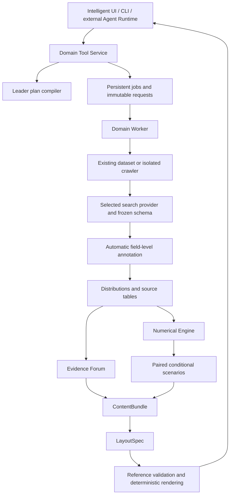

# Tweets2Insights 分层架构

更新：2026-11-03。当前主入口已切换到领域架构。功能脚本完成后统一测试；Demo/真实标注评测后置。

## 依赖方向

- `opinion_core`：类型契约和领域算法；计算不由 Agent 编造。缺失、失败、拒判、中性分别保存。
- `opinion_gateway`：应用入口、存储、预算、供应商装配、持久执行；不依赖旧 PocketFlow。
- `agent_runtime_extension`：领域计划与外部运行时角色/工具绑定；只有一个领域调度者。
- `crawler_worker`：独立进程；仅 keywords 路径进入，上传不会触发采集。
- `intelligent_ui`：通过同一应用服务提交和读取，不直接执行长任务。
- `legacy` 与原 `nodes/flow.py`：显式兼容区域，不参与新默认主链。

## 运行一致性

事件、数据版本和运行 ID 全程绑定。运行请求冻结，产物按内容与类型寻址。
阶段结果只有在持有有效租约时才能提交；最终状态和结果一起发布。取消阻止后续阶段。
重试保留完整检查点，在首次需要重算的阶段清除下游缓存引用。
搜索供应商在请求中固定，所有补证继承该配置；模型/网页内容不能扩大权限或改变预算。

## 业务与数值边界

新标签为平面 topic、publisher、emotion、sentiment 与 target-bound stance。
信念网络、父子主题、publisher_decision 不出现在新默认注册表和报告主链中。
分布窗口使用所有满足筛选条件的帖子，并报告字段分母和缺测；虚拟粒子不替代真实样本。
预测和情景使用独立模型状态与种子；输出分别标记 observed、forecast、simulated、interpretation。
内容先绑定数值/证据，结构只排列已有内容。人工真值只进入独立评测脚本。

完整源码映射、复用清单、连接器协议及研究假设见 [架构重写清单](modules/architecture-rewrite.md)。
入口命令见 [运行手册](modules/domain-application.md)，旧架构见 [历史存档](legacy-architecture.md)。
