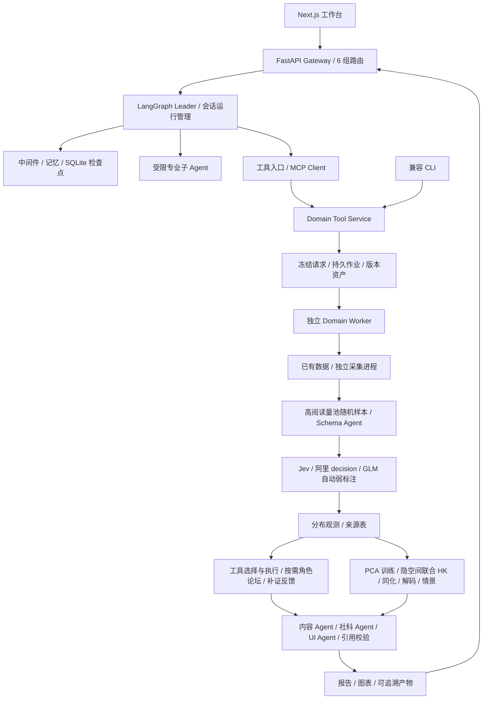

# Tweets2Insights 项目架构

更新：2026-11-03。默认应用采用 Next.js + FastAPI + LangGraph；领域任务由独立 Worker 执行。
DeerFlow 提供运行时分层参考，业务阶段独立设计；论坛以本项目原第二阶段为直接基础，角色和补证路径由任务决定。参考范围见 [Agent Runtime 说明](modules/agent-runtime-architecture.md)。

## 分层与依赖方向

| 层 | 实际位置 | 职责 |
|---|---|---|
| 前端 | `frontend/src` | 会话、上传、结构化配置、SSE 状态、任务及产物 |
| 应用层 | `backend/src/gateway` | HTTP 协议、生命周期、事件范围、会话执行 |
| Agent Runtime | `backend/src/agents`、`subagents` | LangGraph 图、上下文、检查点、有限专业评阅 |
| 通用能力 | `backend/src/models`、`mcp`、`tools`、`skills`、`sandbox`、`config` | 模型和工具适配、技能、受限文件区、配置 |
| 领域核心 | `backend/src/domain/opinion_core` | 契约、确定性计划、弱标注、分析、实验模型和报告 |
| 领域应用服务 | `backend/src/domain/opinion_gateway` | MCP、冻结请求、JobStore、预算、资产和独立 Worker |
| 采集进程 | `backend/src/domain/crawler_worker` | 按需采集、限额、分页、去重和恢复 |

Gateway 可以调用 Runtime；Runtime 不导入 Gateway。领域核心不依赖 Next.js、HTTP 或 LangGraph。
应用包使用 `src.*` 命名空间，避免 `src/mcp` 与第三方 `mcp` 包、`src/config` 与旧 `config.py` 冲突。

## 会话与领域任务

会话状态保存在 `.app-state`，包括线程、消息、显式记忆、SSE 事件和图检查点。
事件数据与领域任务保存在 `.opinion-assets`，按 event/dataset/run 隔离。
Leader 生成或校验 RunRequest；领域 Worker 是唯一领域执行调度者。停止 Agent 与取消已提交 Job 分别操作。
SSE 支持游标续读；Gateway 重启会将未结束的 Agent execution 标为 interrupted，不自动重发模型请求。

## 研究约束

生产流程自动标注，不设置逐条人工验证关卡。人工真值及质量门槛仅用于后置独立 Demo；当前没有 Demo 达标结论。
标签采用平面 topic、publisher、emotion、sentiment 和 target-bound stance；缺失、失败、拒判、中性分开保存。
观测使用所有满足筛选条件的帖子并记录各字段分母；虚拟粒子数不替代真实样本量。
产物区分 observed、forecast、simulated 和 interpretation，数值由领域模块计算，不由 Agent 编造。

## 2.7 项目目录结构总览

完整、可维护的目录表见 [项目目录结构总览](project-structure.md#27-项目目录结构总览)。
复用文件已实际迁入 `backend/src/domain`；根目录旧包保留导入兼容入口，不维护另一份领域实现。
迁移明细见 [重写与复用清单](modules/architecture-rewrite.md)，启动见 [运行手册](modules/domain-application.md)。

## 当前实施状态

架构、功能脚本、启动和部署模板已写入。后端语法/关键导入及前端类型检查已执行；这些不是业务验收。
按用户要求，端到端、真实标注、采集、Demo 和科学实验在脚本完成后统一测试。
Compose/Kubernetes 未部署验证；当前为单操作者环境，无多租户认证；sandbox 是文件能力隔离，不是 OS 执行沙箱。
新 Next.js 已接入交互图表、论坛过程和章节报告；旧 Streamlit 的 PDF 等兼容入口保留。
逐项功能和验证边界见[完整工作流](modules/full-workflow.md)，当前工程检查记录见[实施记录](upgrade-status.md)。
