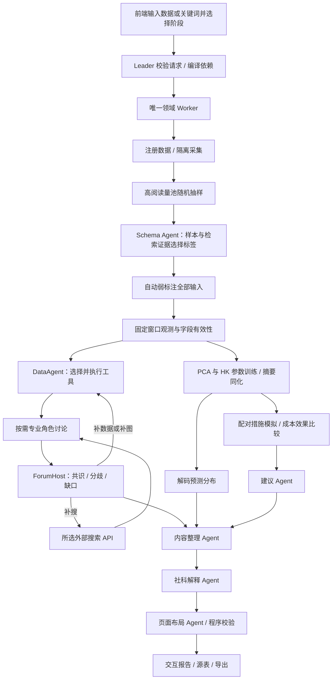

# 完整研究工作流实施清单

更新：2026-11-03。以用户最新描述为准，DeerFlow 只提供分层参考。论坛沿用本项目第二阶段的
CollectTools → DecisionTools → ExecuteTools → ProcessResult → EnsureCharts、SearchAgent、ForumHost
和 supplement_data/search/visual 反馈设计，重新实现隔离的领域工具协议，不固定为三个 Agent。

## 本轮交付项

1. 前端选择数据/关键词输入与复盘、训练预测、情景建议；Leader 编译依赖并依次提交阶段。
2. 随机抽取高阅读量候选记录，由 Schema Agent 结合搜索选择标签；抽样不截断后续分析数据。
3. Typesafe Jev、阿里 decision、GLM 与自定义连接器；用户在本机配置 API 凭据。
4. 41 个保留分析工具迁移到新契约；独立工具目录、参数验证、结果/图表/来源资产。
5. 按需论坛角色、工具自主选择、搜索补证、图表覆盖检查、分歧记录和有界反馈循环。
6. 内容整理 Agent → 人文社科解释 Agent → 页面结构 Agent → 程序校验与智能报告页面。
7. 已确认的 PCA 隐空间训练、联合 HK、观测摘要同化、解码分布预测和滚动诊断。
8. 配对调控情景、效果与资源消耗对照、依据模型结果提出建议并保留假设。

## 实施与验收边界

先完成上述功能脚本与接线，再做统一行为验证；Demo/真实 API 调用和科学实验独立安排。
实现状态由源码接线记录，不能用目录存在代替功能完成。预测方案为本项目实验路线，未宣称复现外部论文。
正式数据自动弱标注，人工标签仅用于独立 Demo。信念网络与 publisher_decision 不恢复。

## 已接入的业务路径

复盘未选中时，不执行工具规划及论坛；预测、情景或滚动诊断需要共同的模型状态。
情景即使单独选择，也会计算配对基线预测。公共前置阶段和最终报告由计划编译器补齐，不能遗漏依赖。
原始数据和每个阶段的资产不覆盖；所有主任务通过同一 JobStore 的租约、心跳、阶段检查点恢复。

## 与原第二阶段的对应

| 原第二阶段职责 | 新实现 | 优化点 |
|---|---|---|
| CollectTools / DecisionTools | `analytics.toolbox.catalog` / `evidence.forum.select_tools` | 真实工具目录、类型化参数、任务关注点；显式选择的工具必须落在预算内 |
| ExecuteTools / ProcessResult | `AnalysisToolbox.execute` | 标准帖子和字段状态、来源表、覆盖率、指纹与不可变结果 |
| SearchAgent | 所选搜索适配器与 search 专业角色 | 固定供应商，按具体证据缺口补搜；来源日期与截止点保留 |
| EnsureCharts / Visual / ChartAnalysis | 图表元数据、覆盖记录、visual 角色和前端绘图 | 图表必须依赖计算源表；缺数不能画成零，缺图可再次调用工具 |
| Insight | insight 角色 | 结合计算和外部来源形成有限解释，保留替代解释 |
| ForumHost | 类型化 HostDecision / Directive | 明确补数、补搜、补图和收敛；保留共识、分歧、理由和操作结果 |
| Supplement / Merge | 有界循环和证据聚合 | 相同工具与参数去重，无新证据、无效主持输出、轮数耗尽分别结束 |
| Report preparation | 内容、社科、布局三个独立 Agent | 数值由程序生成，生成文本只能引用已有证据和内容块 |

五类专业角色是可选职责集合，每次任务可以启用不同子集。ForumHost 是协调者；复盘循环不固定为三个 Agent。
专业角色共享可追溯的证据状态，当前按轮顺序执行，以保证主持决策消费本轮已经完成的意见。
规划层 `src/subagents` 的有限评阅与业务论坛属于不同职责，不能混为已执行的分析。

## 41 个分析入口及语义

| 类别 | 数量 | 内容 |
|---|---:|---|
| 情绪 | 9 | 分布、时间序列、历史窗口异常、趋势/占比、分档、情绪属性、时间/发布者聚焦 |
| 话题 | 9 | 频次、时间演变、线程共现、排序、聚焦、关键词演变、共现网络 |
| 地区 | 8 | 分布、描述性热点、情绪摘要、地区/话题/时间热图 |
| 互动 | 10 | 发布者、交叉表、互动排名、逐对相关、参与者时间与累计变化 |
| NLP | 5 | 关键词、标签/提及共现、文本聚类、词典对照、关键词时间热图 |

入口名称沿用原工具注册表，部分统计与可视化入口共享计算函数，不表示有 41 种独立算法。
全部名称和参数可通过 `GET /api/analysis-tools` 或 MCP `analysis_tool_catalog` 获取。
复盘后可以调用 MCP `submit_analysis_tool`，或在任务面板选择工具，创建基于冻结输入/标签的独立补充作业。

迁移中的实质变化：

- 情感改为 [-1,1]，主题改为平面单选，拒判/失败/缺失不充当有效标签。
- 单帖不再有多话题标签；话题网络统计同一讨论线程里的不同话题，共现单位在产物中明确标注。
- 地区缺失不推断 IP 或坐标；`geographic_heatmap` 为地区交叉热图，不冒充地理底图。
- 互动排名使用确实存在的阅读/点赞/评论/转发字段；Spearman 相关逐对记录完整样本量。
- 继承的实体抽取器仅识别 `#话题#` 和 `@提及`，没有把它称作通用命名实体识别模型。
- 文本聚类使用字符 TF-IDF 和固定种子 KMeans；词典只是诊断对照，不是人工真值。
- 展示 top_n 和图表预览不会改变观测人口；来源表与覆盖分母独立保存。

## 决策模型与抽样

`labeling/sampling.py` 在观测时间/帖子类型/平台范围内筛选候选，再按阅读量分位数和种子随机抽样。
缺少阅读量时，按请求选择显式均匀退化或报错。样本、阈值、池大小和指纹全部保存；事件标签准备缓存包含采样输入。
该样本只帮助 Schema Agent 选词；全体输入仍自动标注，统计再按固定观测筛选和字段有效性进行。

原生接口遵循 [TypeSafe System One](https://docs.typesafe.ai/api/system-one) 和
[阿里云决策模型](https://help.aliyun.com/zh/model-studio/decision-model-api)：每帖五个 choice 问题共享一次请求，
保留完整概率、供应商置信度和前两项概率差距；unknown、低置信度或小差距自动拒判。
真实 API 尚未调用，不能把协议实现说成真实服务已验收。
Jev/阿里只承担结构化决策；Schema、论坛、内容、社科和布局使用独立 `agent_model`。

## 实验预测与调控建议

1. 原始联合向量为 topic/emotion 单纯形坐标加 stance/sentiment 编码。
2. PCA 在 `training_cutoff` 以内的联合有效样本上拟合，保存均值、主轴、维数、解释方差和截止点。
3. HK 在隐空间使用联合欧氏距离建立置信邻域；不是逐坐标独立 HK。
4. EnKF 的预测观测算子先解码，再计算一阶/二阶分布摘要，与真实帖子摘要同化；不逐帖匹配虚拟粒子。
5. 解码类别块投影到单纯形，连续坐标裁剪到 [-1,1]，输出情绪/立场分布、类别质量和集合区间。
6. epsilon/relaxation 在训练段内用最近至多三个滚动验证起点选择；每个起点重新仅拟合历史前缀 PCA。
7. 滚动诊断比较 latent、joint、coordinate、无同化、持久性和线性分布基线，使用相同联合有效样本人口。

PCA 几何、低秩重构、投影、噪声和有限集合近似都属于本项目实验假设。
参数拟合损失不等于独立测试成绩，集合离散区间不等于已校准置信区间。
标签定义和搜索若没有历史可用性证明，`historical_availability_verified` 仍为 false。

措施可通过状态偏移、置信邻域变化或松弛率变化表达；每个分支从同一模型状态与随机流开始。
输出轨迹、均值差、最终立场方差、负面情绪质量和资源成本；按“降低立场方差/降低成本”给出 Pareto 标记。
建议 Agent 只能解释已提供的措施、假设和计算结果。参数与现实措施的因果对应未被验证，建议必须保留适用条件。

## 内容与智能报告

内容服务先生成带数值占位符、证据引用和资产版本的事实块；ContentAgent 阅读全部工具摘要，提炼概述并排序。
SocialScienceAgent 使用可配置的框架、议程设置、风险沟通理论条目解释现象，并说明适用边界。
ReportUIAgent 只生成标题、章节与既有块引用；程序校验每个块恰好出现一次，禁止生成任意脚本。
前端按布局呈现报告、交互图表、证据和来源表，静态 HTML/Markdown/ZIP 保留图表，完整 JSON 保存全部数据。
无效内容/理论输出会被拒收或标为 partial；无效布局使用可追溯内容的确定性排列。

## 当前验收范围

本轮功能脚本完成后，开始 `backend/tests/test_workflow_contracts.py` 的离线工程检查，包含 41 个工具入口、
阶段依赖、采样人口隔离、供应商协议、概率拒判、PCA 截止点、配对空措施、论坛补调用及 Worker 资产链。
所有记录和供应商输出均为工程夹具，不作为人工 Demo 或真实服务结果。
真实模型/搜索/采集、浏览器体验、独立人工 Demo、科学预测效果及容器部署分别保留待验收状态。
最新命令和结果见[实施记录](../upgrade-status.md)。
