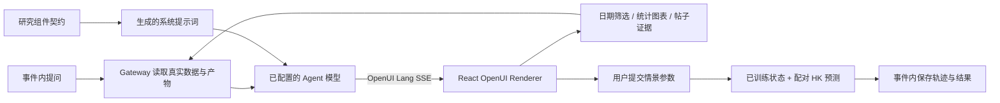

# OpenUI 交互分析

Tweets2Insights 在现有 Next.js 工作台中集成 `@openuidev/react-lang` 与 `@openuidev/lang-core` 1.0.0。参考 [Open Intelligent UI](https://github.com/thesysdev/open-intelligent-ui/tree/16ef26475999e3a021a50b1607a03717c0721255) 的组件库、提示词生成和流式 Renderer 方式；事件导航、服务端凭据、研究调度和数据仓库继续使用本项目实现。

## 数据流



## 组件契约

`frontend/src/lib/openui-schema.mjs` 是组件名称、位置参数和 Zod Schema 的共同来源。

| 组件 | 作用与数据来源 |
|---|---|
| ResearchView / Grid | 纵向画布与响应式分组 |
| Heading / Summary | 标题与模型解读；作为纯文本渲染 |
| Metric | 从当前数据集统计解析指标，模型只选择指标名 |
| Chart | 从服务端图表目录按 key 取图表，支持原有源数据表与交互 |
| Filters | 日期与平台条件；提交后从原始帖子重新统计 |
| Evidence | 当前筛选范围内的高互动帖子、时间和互动数 |
| Scenario | 选择模型、预测步数、维度、偏移、持续步数与假设，用户点击后计算 |
| Navigate | 在当前事件内切换工作台、预测、报告、进程或数据页面 |

模型不提供 Metric/Chart 的数值，不执行 HTML 或任意脚本。Renderer 的组件目录不含 HtmlView、外部查询或写入动作。数据集统计跟随筛选；历史分析图表保持运行范围并标明来源。模型解读记录生成范围，筛选改变后可重新生成。

提示词由同一组件契约生成并随包发布：

```bash
npm --prefix frontend run openui:generate
npm --prefix frontend run openui:check
```

修改组件名称、参数顺序或 Schema 时重新生成 `backend/src/gateway/openui_prompt.txt`。SDK 自动注入的开发调试组件通过 Next.js 别名关闭；运行页面不加载其 CDN 调试界面。

## Gateway 接口

接口前缀为 `/api/threads/{thread_id}/intelligence`，事件由服务器从线程记录解析。

| 方法与路径 | 内容 |
|---|---|
| GET `/context` | 接受 dataset_id、start、end、platform，返回统计、图表目录、证据与可用训练版本 |
| POST `/chat` | message、locale、page、filters；返回 status / delta / complete / error SSE |
| GET `/messages` | 当前线程的助手对话、生成状态、Token 用量和错误 |
| POST `/simulate` | job_id、horizon、dimension、shift、duration、assumption；计算配对情景 |
| GET `/simulations` | 当前线程最近十次交互情景结果 |

生成沿用 Agent 模型的 Base URL、Model ID、API Key 和生成参数，服务端请求 Chat Completions 流。每次最多输出 8192 tokens / 64000 字符，返回用量随对话保存。原有领域预算不计入交互助手调用；界面展示供应商返回的 Token 用量。无需额外 Thesys Cloud 凭据。

对话通过线程事件表中的 `ui_message` 保存，情景历史使用 `ui_simulation`；删除事件时随已有事件记录清理。输入数据集仍按原规则保留。开始执行锁阻止同一线程同时运行 Leader 与交互计算；模型失败保存脱敏异常，用户停止会终止流请求。

## 条件情景

交互情景只接受当前事件已完成运行的 `state` 资产。服务端复制状态、替换 horizon，调用 `compare_scenarios`，不覆盖训练结果。预测步数为 1–30，状态偏移为 −1 至 1，持续步数不超过预测范围，从第 1 步开始施加。输出含基线、情景轨迹、参数、假设、来源运行与下载引用。

零偏移不再触发额外的 PCA 解码重编码，保证与同随机流基线逐步一致。非零偏移沿用既有投影和演化计算。尚无训练状态的事件显示训练入口。

## 验证

`backend/tests/test_intelligent_ui.py` 验证真实统计筛选、事件隔离、生成历史、失败脱敏、删除保留输入，以及使用小规模真实 PCA/HK 计算验证零偏移、非零偏移和原状态不变。`frontend/tests/openui.test.mjs` 用实际 SDK 解析中英文初始画布及组件边界；`ui-stream.test.mjs` 覆盖跨字节中文 SSE 和错误事件。

```bash
uv run --project backend pytest backend/tests -q
npm --prefix frontend test
npm --prefix frontend run check
npm --prefix frontend run build
```

操作说明见[前端工作台](../frontend-guide.md)。
